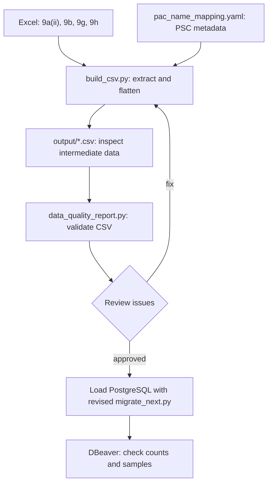

# Attachment 9 Excel to PostgreSQL pipeline

| Input | CSV | Database table | Grain |
| --- | --- | --- | --- |
| 9a(ii) + nonzero FY activities from 9b | `output/masterplan.csv` | `public.abd_masterplan_combined_stg` | field + year |
| 9g | `output/decom_summary.csv` | `public.abd_decom_summary_stg` | field |
| 9h facility sections | `output/decom_facility.csv` | `public.abd_decom_facility_stg` | field + source row |
| 9g left join 9h | `output/decom_combined.csv` | `public.abd_decom_combined_stg` | facility section or unmatched 9g field |

## Run order in `C:\devops\data migration`

1. Put the workbook and supplied `.py`/`.yaml` files in this folder. Install `openpyxl` and `pyyaml` in the selected Python environment; database loading also needs `psycopg`.
2. Verify the PSC metadata in `pac_name_mapping.yaml` against the workbook cover page, especially spelling and the `SK` region code. `field_id`, `sheet_id`, `submission_date` and operator need authoritative mappings and remain unresolved.
3. Run `python build_csv.py`. This reads Excel and writes four CSV files to `output/`, without touching PostgreSQL.
4. Run `python data_quality_report.py`. Review `output/data_quality_report.csv` and `output/data_quality_details.csv` before any database load. Unexpected duplicate or unmatched activity is a blocker; workbook blanks can be reviewed separately.
5. **Integration required:** your existing `migrate_next.py` still reads Excel directly. Update it to read these validated CSVs and use `environment.yaml` before claiming CSV-first database loading. The config holds a password environment variable *name*, never the password itself.
6. In DBeaver compare sample records and row counts after the revised loader runs. Earlier workbook counts: 35 masterplan, 7 9g summaries, 35 9h sections, 37 combined rows.

## Rules and limits

- Blank numeric cells and `-` become empty CSV cells; zero stays zero. The 9a(ii) years become `(field, year)` rows. The 9b extraction retains FY costs that are nonzero.
- Masterplan key: `(field, year)`. 9g key: `field`. 9h key: `(field, source_row_9h)`. A field can have repeated facility names, including two `Terminal` sections. Keep the source-row key in the facility staging CSV even though the combined presentation CSV hides it.
- 9g field totals repeat on each matching facility row. Do **not** sum them across `decom_combined.csv`. An unmatched 9g field has a blank facility; previously Bayan NAG and Ridwan.
- Workbook-level PSC metadata repeats on exported rows. `psc_contractor` is a cover-page code, and is not automatically the `operator` DB value. The PAC name aliases remain empty until exact legal names and codes are verified.
- The small EUR/cess table in 9a(ii), item-level detail within 9h, and zero-FY activities in 9b are outside this current extraction.
- Your earlier combined-table `DELETE` + `INSERT` refresh changes row IDs and creation timestamps. Before using audit fields as stable history, agree on a row key and update matching rows in place.
